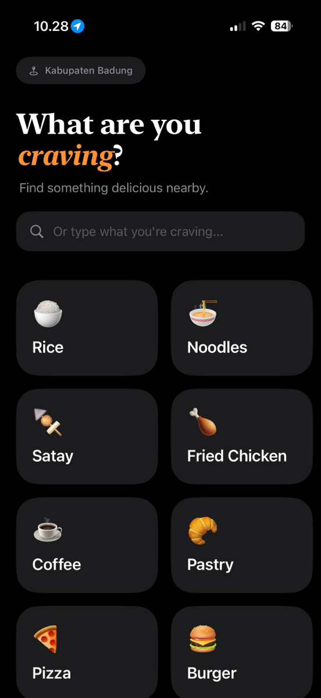
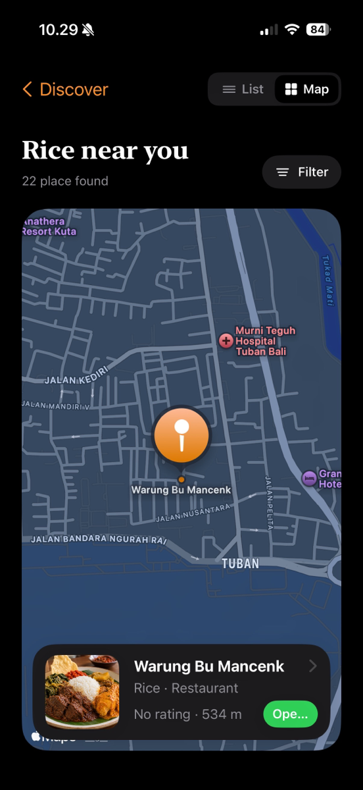
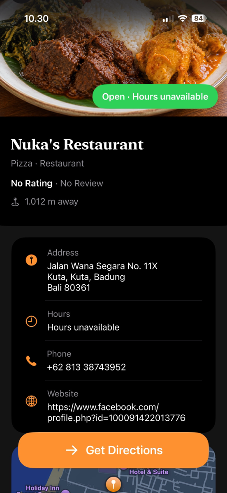
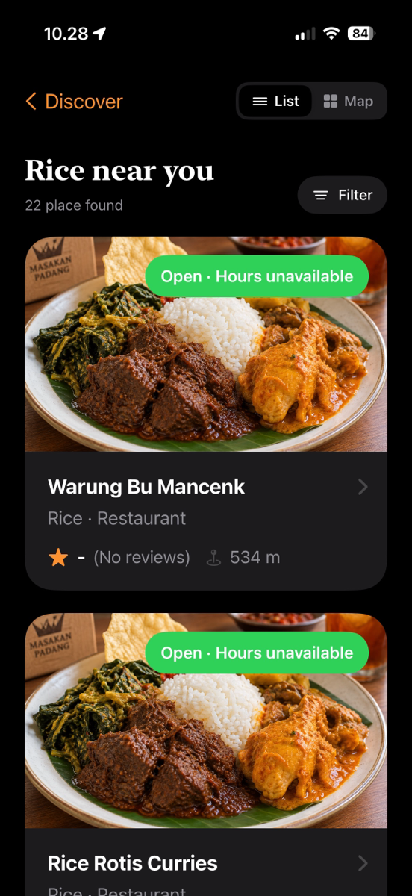
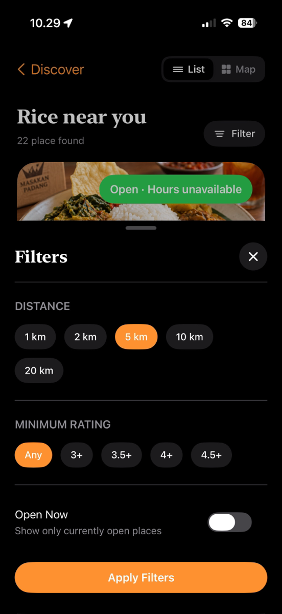
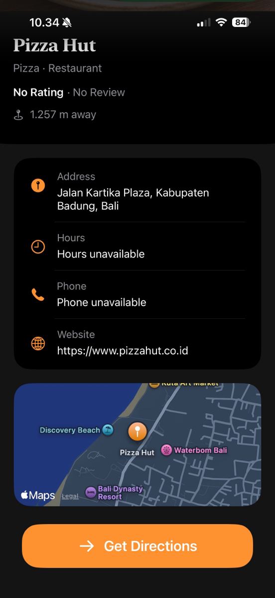

<p align="center">
  
</p>

# iEat

A culinary app that helps you find something to eat nearby. Built as a solo project for **Challenge 6 (SOLO)** at Apple Developer Academy @ BINUS – Bali.

In this challenge, each of us chose the Swift concepts we wanted to learn and applied them in our own app. I picked **structures, classes, optional values, and inheritance**, and added **MapKit** to push myself further.

<p align="center">
  
  &nbsp;
  
  &nbsp;
  
</p>

## Features

- **Pick a craving:** choose a food category or type your own
- **Nearby search:** finds places around your current location with MapKit
- **List and map views:** switch between a scrolling list and an interactive map
- **Filters:** distance, minimum rating, and open now
- **Place details:** address, opening hours, phone, website, and a mini map
- **Get Directions:** opens the route in Apple Maps

## What I Learned

| Concept | Where it lives |
|---|---|
| **Structures** | `FoodPreference` is a value type for each craving category |
| **Classes** | `Place` is the base class for every search result |
| **Optional values** | Rating, review count, phone, website, and opening hours are optional, because MapKit doesn't always return them, so the UI falls back to "unavailable" instead of crashing or showing blanks |
| **Inheritance** | `Restaurant` inherits from `Place` and adds its cuisine |

All of these live in [`iEat/Model/CulinaryModels.swift`](iEat/Model/CulinaryModels.swift).

## Screens

<table>
  <tr>
    <td align="center"><br>Home</td>
    <td align="center"><br>List</td>
    <td align="center"><br>Map</td>
  </tr>
  <tr>
    <td align="center"><br>Filters</td>
    <td align="center"><br>Place Detail</td>
    <td align="center"><br>Place Detail</td>
  </tr>
</table>

## Tech Stack

- Swift, SwiftUI
- MapKit (`MKLocalSearch`, `Map`, `MKMapItem`)
- Core Location
- Combine (`ObservableObject` view model)

## Getting Started

Requirements: Xcode 26 or later, iOS 26.5 or later.

1. Clone the repo
   ```bash
   git clone https://github.com/StevanusFelixiano/iEat.git
   ```
2. Open `iEat.xcodeproj` in Xcode
3. Select an iPhone simulator or device and press **Run** (⌘R)
4. Allow location access so iEat can find places near you
